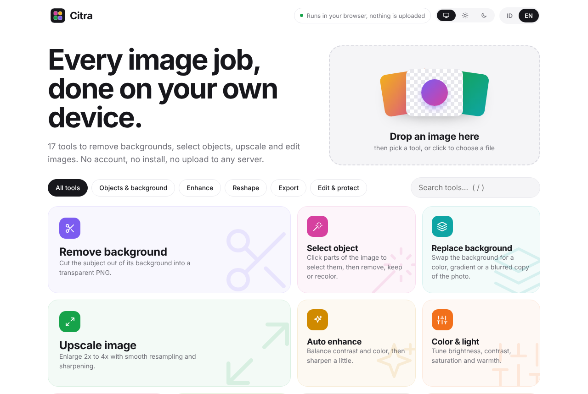
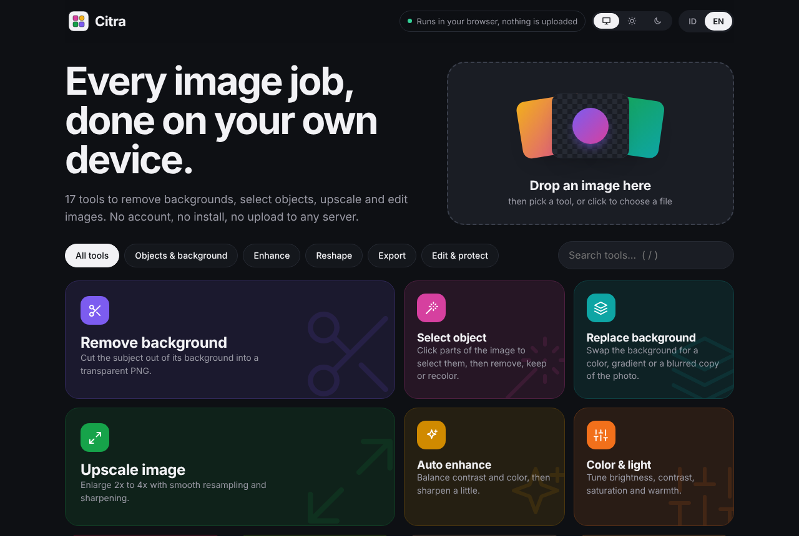
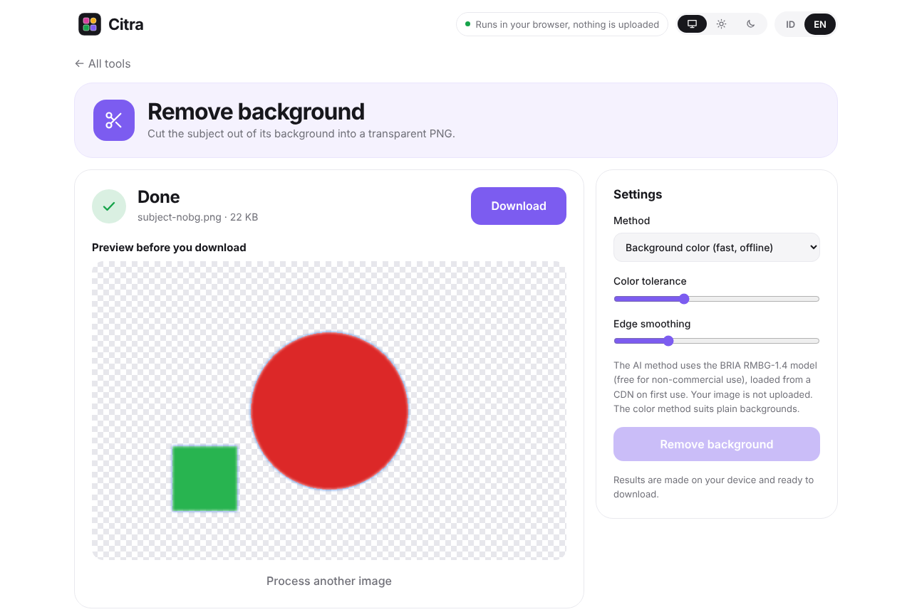
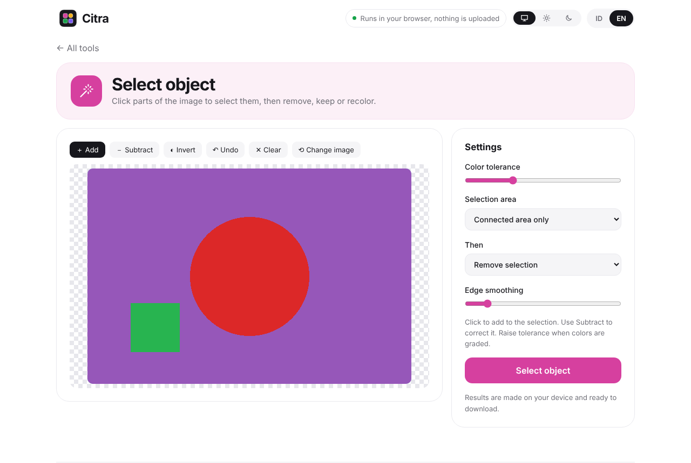

# Citra

**Alat gambar pribadi yang berjalan di browser.** Hapus background, pilih objek, perbesar, potong, dan edit gambar tanpa akun, tanpa instal, dan tanpa mengunggah gambar ke server.

🇬🇧 English summary is at the bottom.

| Terang | Gelap |
|---|---|
|  |  |

| Hapus background | Pilih objek |
|---|---|
|  |  |

## Fitur

17 alat, dua bahasa (Indonesia dan Inggris), tema terang, gelap, atau mengikuti browser. Semua alat yang mendukung banyak file bisa memproses sekaligus dan menghasilkan zip.

| Kategori | Alat |
|---|---|
| **Objek dan background** | **Hapus background** (AI atau warna latar), **Pilih objek** (klik untuk memilih area), Ganti background (warna, gradasi, atau blur) |
| **Perbaiki** | Perbesar gambar (2x sampai 4x), Perbaiki otomatis, Warna dan cahaya, Filter foto |
| **Ubah bentuk** | Potong gambar (rasio terkunci), Ubah ukuran, Putar dan balik, Bingkai dan bayangan, Gabung gambar (kolase) |
| **Ekspor** | Kecilkan ukuran, Ubah format (PNG, JPG, WebP, EXIF ikut terhapus) |
| **Edit dan lindungi** | Sensor area (piksel, blur, blok hitam), Tambah teks, Watermark |

Selain itu: pratinjau langsung untuk alat penyesuaian, pembanding sebelum dan sesudah, tempel gambar dari clipboard, dan bisa dipasang di HP sebagai aplikasi (PWA).

## Privasi

Semua pemrosesan berjalan di browsermu. Gambarmu **tidak pernah diunggah**. Buka DevTools (`F12`), tab **Network**, lalu proses sebuah gambar untuk membuktikannya.

Dua hal yang tetap terjadi: font dimuat dari Google Fonts, dan **metode AI di Hapus background** mengunduh pustaka dan model sekali dari CDN (±44 MB, lalu disimpan di cache browser). Hanya model yang diunduh, gambarmu tetap di perangkatmu.

## Menjalankan

Unduh repositori ini lalu klik dua kali `index.html`. Semua alat berjalan tanpa server. Metode AI butuh internet untuk mengunduh modelnya sekali. Untuk mencoba PWA, jalankan `python -m http.server 8000` dan buka `http://localhost:8000`.

## Memasang secara gratis

Citra adalah situs statis: GitHub Pages (Settings, Pages, branch `main`, folder `/ (root)`), Vercel (Framework Preset **Other**, Output Directory `.`, Build Command dikosongkan), Netlify, atau Cloudflare Pages.

## Membangun dari kode sumber

Kode yang diedit ada di `src/app.html`. `build.mjs` menyisipkan JSZip lalu menulis `index.html`.

```bash
npm ci && npm run build
# opsional, agar pratinjau link terisi:
SITE_URL=https://nama.vercel.app npm run build
```

Setelah mengubah situs yang sudah dipasang, naikkan nomor versi di `sw.js` (`citra-v1` menjadi `citra-v2`).

## Batasan

- **Perbesar gambar** memakai resampling berkualitas tinggi dan penajaman. Ini bukan AI yang menambah detail baru. Hasil dibatasi sekitar 64 megapiksel.
- **Hapus background metode Warna latar** cocok untuk latar polos. Untuk foto rumit, pakai metode AI.
- **Pilih objek** memilih area berdasarkan kemiripan warna, bukan mengenali objek.
- **Sensor area** manual. Tidak ada deteksi wajah otomatis.
- Format HEIC dan SVG belum didukung. Gambar sangat besar bergantung pada memori browser. Safari di iPhone membatasi ukuran kanvas lebih kecil dari browser desktop.

## Model AI dan lisensi

Kode Citra berlisensi [MIT](LICENSE). Metode AI memuat [Transformers.js](https://huggingface.co/docs/transformers.js) (Apache-2.0) dan model BRIA **RMBG-1.4** dari Hugging Face. Lisensi model itu **tidak untuk pemakaian komersial** menurut kartu modelnya, jadi periksa lisensinya sebelum memakai Citra untuk bisnis. JSZip berlisensi MIT atau GPL-3.0. Font Bricolage Grotesque dan DM Sans berlisensi SIL Open Font License.

---

## English summary

**Citra is a private image toolkit that runs in your browser.** 17 tools: remove background (AI or background color), select object, replace background, upscale, auto enhance, color and light, photo filters, crop, resize, rotate and flip, frame and shadow, collage, compress, convert, censor areas, add text, watermark. Bilingual (ID/EN), light/dark/system theme, installable as a PWA.

Images are never uploaded. The AI background removal downloads Transformers.js and the BRIA RMBG-1.4 model (about 44 MB, cached) from a CDN on first use. RMBG-1.4 is licensed for non-commercial use only, so check its license before commercial use. Build with `npm ci && npm run build`. Code is MIT licensed.
